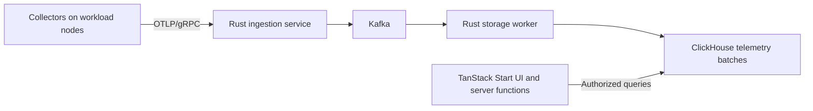

# Architecture

The system collects resource measurements from distributed workloads and relates them to executions, processes, and nodes. Live views and post-mortem analysis use the same measurements. Workload-specific details are metadata, so collection and analysis can support different applications.

The web application uses TanStack Start and shadcn/ui. The Rust collector samples Linux node/process resources with verified process identity, coverage diagnostics and counter continuity. It persists pending batches locally and retries temporary failures with stable batch IDs. Source credentials bind uploads to enrolled project/source identities and hosts. The Tonic ingestion service validates metrics and waits for Kafka publication before acknowledging them. The storage worker writes complete batches to ClickHouse. Authorized execution pages show fixed-window node context; they do not establish workload attribution or completion. Trace storage and execution associations remain unimplemented. See the [local pipeline](../infra/telemetry/README.md) and [execution semantics](execution-telemetry.md).

## Component responsibilities

| Component                  | Responsibility                                                                                                                   |
| -------------------------- | -------------------------------------------------------------------------------------------------------------------------------- |
| Rust collector             | Collect node and process measurements, batch samples, and buffer pending uploads; execution attribution needs platform evidence. |
| Rust ingestion service     | Authenticate sources, validate batches, apply admission limits, and publish accepted telemetry durably.                          |
| Storage worker             | Consume retained batches, process measurements, and publish analytical data.                                                     |
| TanStack Start application | Render the interface with SSR, manage browser sessions, and authorize queries and exports through server-side application code.  |
| Kafka                      | Retain accepted batches independently of processing and track consumer progress.                                                 |

TanStack Start provides the web application's server-side functions and endpoints. Collectors export telemetry to the Rust ingestion service. Human sessions and execution access are managed in the web application; collector authentication and durable acceptance are enforced by the ingestion service.

The ingestion and storage worker are separate executables in `apps/server`. The ingestion executable serves telemetry export and health RPCs. The worker uses a restricted ClickHouse writer; application queries use a separate read-only credential. PostgreSQL owns authorization and execution metadata, not telemetry analytics.

## Data flow

Collectors send OTLP batches over gRPC with binary Protobuf. The ingestion service validates identity, access, schema, and size before acceptance. Acceptance follows successful Kafka publication; processing then writes measurements to analytical storage.

The broker belongs behind the ingestion API. Collectors need neither broker credentials nor knowledge of topics, partitions, or consumers.

See [ingestion server](ingestion-server.md) for the Tonic choice and receiver behavior, [ingestion and reliability](ingestion-and-reliability.md) for acceptance and recovery, [broker options](broker-options.md) for broker alternatives, and [serialization](serialization.md) for formats at each boundary.

## Storage and recordings

Rust is used for collection, ingestion and storage processing. ClickHouse retains a typed point array and the supported OTLP payload in one atomic batch row. Queries deduplicate whole batches before filtering or aggregating points. The server deduplication window and background merges are not correctness boundaries. Telemetry transport uses OTLP/gRPC with binary Protobuf; Kafka retains a Protobuf ingestion envelope. Application RPCs preserve `Date` values and use decimal strings for exact 64-bit telemetry values. Portable exports remain unimplemented.

Broker retention covers processing recovery. Historical storage has its own retention policy for post-mortem analysis. Expiring a broker record should not delete its archived measurements.

## Identity and privacy

Browser authentication and collector authentication serve different purposes. SAML SSO is a candidate for human login. Collectors use separate credentials scoped to their permitted nodes and projects. TanStack Start enforces execution access on queries and exports; the ingestion service enforces source and project access on incoming telemetry.

SSO establishes identity; authorization determines which measurements that identity can access. Broker connections belong to backend services, with permissions limited to the streams or topics they need.

Use encrypted transport outside the isolated local environment. Collect only the process metadata needed for attribution; command arguments, environment variables, and workload payloads can contain private data. Retention and export permissions apply to raw captures as well as derived results.

## Measurements and validation

Each measurement needs its source, unit, collection time, and node or process context. Preserve missing samples, collector disconnections, and clock uncertainty. A shared timeline can reveal correlated changes; a controlled experiment is needed to attribute a slowdown to a competing workload.

The [test environment](../infra/test-environment/README.md) provides two Vagrant VMs provisioned with Ansible and the Tonic server in Compose. Standard gRPC health probes check connectivity. Separate workload playbooks run stress-ng for CPU and memory pressure and fio for I/O, with commands, tool versions, and results retained locally. The separate [telemetry pipeline](../infra/telemetry/README.md) enables metrics acceptance and analytical queries. The original environment server keeps acceptance disabled when no source policies are configured.

Validation should cover baseline executions, overlapping workloads, and controlled resource contention. Existing workload tools can provide repeatable load; synthetic event generators can exercise ingestion volume and malformed inputs. Record workload versions, commands, resource allocations, and sampling settings with the results.

Measure collector overhead, ingestion throughput, sample-to-query delay, and missing or duplicate samples. The local environment supports functional and controlled performance experiments; it does not establish production HPC capacity.
