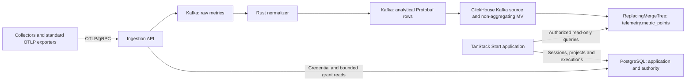

# Architecture

Recount collects resource measurements from distributed workloads and presents authorized execution-window context. The current ingestion path is authenticated OTLP → raw Kafka → Rust normalizer → normalized Kafka → native ClickHouse Kafka source/materialized view → `ReplacingMergeTree` points. PostgreSQL holds application, session, execution and credential authority only. Analytical visibility can be partial and delayed; there is no whole-batch visibility gate.

The web application uses TanStack Start and shadcn/ui, with shared English/French catalogs and localized transactional emails. Better Auth manages human sessions, email-code sign-in and passkeys. Collector bearer credentials are separate from those sessions. Existing execution pages provide fixed-window node context, not proof of workload attribution or completion. Trace storage, automatic execution associations and a live-streaming UI remain outside the implemented ingestion path. See [execution semantics](execution-telemetry.md) and the [web application](../apps/web/README.md).

## Component responsibilities

| Component                  | Responsibility                                                                                                                                                                   |
| -------------------------- | -------------------------------------------------------------------------------------------------------------------------------------------------------------------------------- |
| Linux collector            | Sample node and verified process resources; persist immutable pending uploads and retry temporary failures.                                                                      |
| Ingestion API              | Authenticate each submission, resolve root/independent-resource grants, validate the whole request and exact output expansion, then acknowledge confirmed raw Kafka publication. |
| Normalizer                 | Revalidate retained context and publish one bare point per record; RustStream tracks settled prefixes only after every required output acknowledgement.                          |
| Kafka                      | Retain raw and normalized records separately and track each downstream group's progress.                                                                                         |
| ClickHouse                 | Consume normalized Protobuf through its native Kafka engine and a non-aggregating materialized view into point rows.                                                             |
| TanStack Start application | Manage application state and independently authorize private server operations before querying ClickHouse with a read-only account.                                              |
| PostgreSQL                 | Maintain Better Auth memberships/sessions, projects, execution windows and indexed collector credential/root/resource grants.                                                    |

The deployable Rust services are `apps/collector`, `apps/ingestion-api` and `apps/normalizer`. The normalizer needs Kafka only, not PostgreSQL or ClickHouse credentials. There is no Rust storage service, direct ClickHouse application writer or PostgreSQL telemetry acceptance ledger. Pure generated schema/identity/projection code lives in `crates/telemetry-schema`; semantic and resource-policy checks live in `crates/telemetry-validation`.

## Data flow

Collectors need no broker credentials or partition knowledge. The API retains a generated `RawRecord` with trusted project/source, resolved access, unchanged OTLP ordering and submission metadata. The normalizer reuses admission's shared validation and projection, then publishes each bare `AnalyticalPoint` separately across explicit stream-affinity partitions. Native ClickHouse consumes `ProtobufSingle`.

Raw routing spreads immutable submissions; normalized routing gives streams explicit fixed-partition affinity. Neither promises global event-time order, especially across concurrent raw partitions. Preserve late and out-of-order observations with their original times. Exact messages, routing, limits and fidelity rules are in the [telemetry point contract](telemetry-point-contract.md), not a second application model.

## Acceptance, storage and recovery

Raw acknowledgement, normalized publication/input checkpointing and ClickHouse storage/downstream checkpointing are separate at-least-once boundaries. None is a distributed transaction. A timeout or crash can leave acknowledgement uncertain; retries preserve original identity, values and positions. RustStream owns worker dispatch and tracked prefixes; periodic commits follow required output acknowledgements. There is no custom normalizer polling/recovery state machine.

ClickHouse stores one observation per row, with native typed scalar/distribution/attribute projections. The target partitions by UTC event day and sorts project-first with immutable sample identity in the replacement key. One histogram observation retains its bucket structure in one row. The schema and generated SQL columns derive from the same `recount.proto` artifact.

Replacing merges clean up physical retries but do not make ordinary reads immediately unique. Current duplicate-sensitive readers use `FINAL` before bucketing/calculation and keep continuity segments separate. Different original observations are not collapsed merely because their timestamps or values match. There is no permanent first-content-winner registry: changing content under a reused immutable producer identity violates the protocol.

Invalid retained input or a failed publication takes explicit global handler fail-stop, leaving unfinished input unsettled. Startup validates declared topology, effective caps and initial checkpoints before publication; these are snapshots, not assignment/retention watchers. Later native consumption errors can remain logged while running, with reset=`error` rather than implicit suffix selection. Fresh groups require deliberate initialization. The [normalizer reference](../apps/normalizer/README.md) states these accepted development limitations; short retention and process liveness do not establish high availability or ongoing readiness.

## Identity, authority and privacy

Project, reporting source, observed resource, stream and sample are distinct identities. A source may report several resources, and credential rotation does not create a new source or observed resource. The ingestion API checks current credential digest, revocation and expiry on every submission, then fetches only the bounded distinct root and independent-resource authority keys requested by that submission.

An enrolled root grants reporting within its namespace and explicitly allowed adapter/local kinds. The Linux adapter derives process-local identity from root, boot, namespace, PID and start ticks without enrolling/querying every PID. Independent VMs/devices require exact typed bindings. Neither a payload parent/placement assertion nor an empty grant list expands authority; root scope is not physical attestation. The normalizer validates accepted stored context without refreshing current credentials, grant policy or upload age.

Private application reads independently authorize project access through Better Auth's canonical memberships. Route context and browser guards are not authorization boundaries. Keep ingestion's read-only authority role separate from the application's database role and ClickHouse query credential. See [collector credentials](collector-credentials.md) and [application access](application-access.md).

The isolated development network uses plaintext OTLP/Kafka; production transport security is not supplied by that isolation. Do not log tokens or payloads. The Linux collector excludes arguments, environment variables, executable paths, application files and process memory. Retention/access policies apply to pending buffers, retained raw records and analytical projections alike.

## Measurements and validation

Preserve exact values, optional/no-recorded states, resource/scope attributes, source timestamps and continuity. Missing measurements are not measured zero. Submission-age/clock policy applies to declared batch creation, not individual measurement age; no blanket measurement-age/future cutoff or timestamp rewriting is introduced.

The [optional Linux lab](../infra/lab/README.md) supplies independent guests, monitoring and controlled stress-ng/fio workloads. It reaches the separately provisioned Recount stack; a gRPC connectivity probe does not prove authenticated acceptance or analytical visibility. Compile Linux application/test artifacts on the host and execute them in allocated Linux environments.

Validate semantic fixtures separately from real Kafka/MV replay, poison, checkpoint ambiguity, retention gaps and browser authorization. Measure collector overhead, peak decoded memory, backlog recovery, low-volume latency and sample-to-query delay with representative workloads before making capacity claims. Configurable byte/row/concurrency bounds are provisional safety controls, not a demonstrated HPC or IoT fleet budget.

## Local diagram sources

Editable [current-architecture](current-architecture.puml), [telemetry-flow](telemetry-flow.puml) and [telemetry-retry](telemetry-retry.puml) PlantUML drafts and their rendered files are retained with shared styling in `diagram-style.iuml`. Rendering tools are not managed by this repository. Those drafts predate the current implementation and must be updated before being used as architecture references; the flow above describes the current services.
